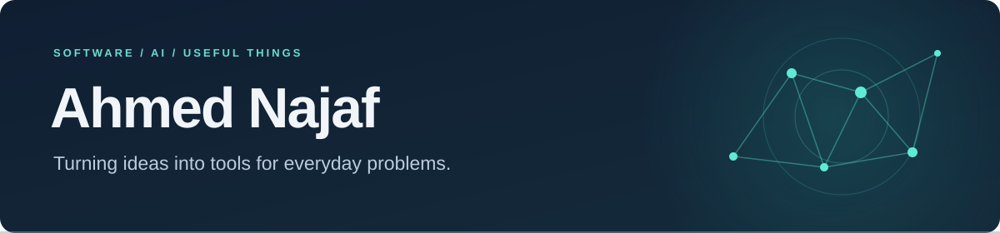

I build web apps and AI tools, with projects spanning accessibility, sustainability and preventive health.

**MSc Computer Science with AI · Keele University**

[Website](https://ahmednajaf.vercel.app) · [LinkedIn](https://www.linkedin.com/in/ahmednajaf/) · [Email](mailto:ahmednajaf261@gmail.com)

---

## Selected work

| Project | What I'm building |
| :--- | :--- |
| **[OpenRead](https://github.com/ahmednajaf/openread)** | An open-source reading companion for Safari and Chrome on Mac, with local voices, word highlighting and document support. [Demo & installation →](https://getopenread.vercel.app) |
| **[Vero](https://github.com/ahmednajaf/vero)** | Sustainability intelligence that brings company reports, peer comparisons and source-linked evidence into one workspace. |
| **[Well Ahead](https://github.com/ahmednajaf/wellahead)** | A collaborative hackathon prototype for preventive health, combining voice-led check-ins, interactive anatomy and personalised planning. |
| **[Carbonly](https://github.com/ahmednajaf/Carbonly)** | My MSc project: an activity-based carbon footprint tracker with emissions dashboards and AI-assisted sustainability tips. [Live demo →](https://trackcarbonly.vercel.app/) |

## Tools I work with

**Languages** &nbsp; Python · JavaScript · TypeScript 
**Web** &nbsp; React · Node.js · Express · Tailwind CSS 
**Data & tooling** &nbsp; PostgreSQL · Firebase · Git

## What connects these projects

I'm interested in making complex information easier to use: helping people read, understand sustainability evidence, or navigate a health plan. I enjoy working across the interface, backend and AI features to turn that into a usable product.

---

Have feedback on a project or an idea to collaborate on? [Get in touch](mailto:ahmednajaf261@gmail.com).
